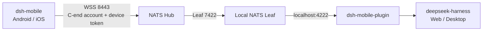

<div align="center">

[简体中文](README.md) · **English**


# dsh-mobile-plugin

**A Cordis plugin that brings a local DeepSeek Harness instance to your phone securely.**

The plugin connects outbound to a NATS Hub and bridges dsh RPC calls and real-time events to [dsh-mobile](https://github.com/EarhartZhao/dsh-mobile). Your computer does not need a public IP address or any inbound port.

<p>
  <a href="https://registry.npmjs.org/%40dsh-earhartzhao%2Fdsh-mobile-plugin"></a>
  <a href="https://github.com/EarhartZhao/dsh-mobile-plugin/releases/latest"></a>
  <a href="https://github.com/EarhartZhao/dsh-mobile-plugin/actions/workflows/ci.yml"></a>
  
  
</p>

[Quick start](#quick-start) · [Install](#install) · [Initial setup](#initial-setup) · [Mobile app](https://github.com/EarhartZhao/dsh-mobile) · [Self-host a Hub](docs/03-nats-self-host.md)

</div>

## Why this plugin exists

dsh usually runs on a home or office computer without a public IP address. A phone cannot reach it directly, and exposing dsh to the public Internet increases the attack surface.

This plugin reverses the connection direction: the computer and phone both connect outbound to the same NATS Hub. The Hub only forwards traffic, while the plugin keeps running inside the dsh process. Sessions, approvals, questions, files, and tool events therefore all come from the same host.



## Capabilities

| Connectivity | Security | Mobile experience |
| --- | --- | --- |
| Outbound host connection with no inbound port | QR pairing with individually revocable device tokens | Full RPC, live event streams, and paged history |
| Reuses dsh Typert Remote and event vocabulary | Hub CA delivered in the QR payload; no built-in account | Subagents, approvals, questions, queues, and files |
| Local NATS discovery, launch, and link diagnostics | A separate `instanceId` for every installation | Shared configuration between the plugin page and local console |
| npm, Release tarball, Git, and local link installs | Secrets kept out of the mobile wire and diagnostics | In-console update checks and restart guidance |

## Quick start

Prepare three things:

1. A computer that can run `dsh web`.
2. A NATS Hub URL, a C-end account and password, and the Hub's `ca.crt`.
3. A local `nats-server` and `leaf.conf`. If they are missing, follow the [AI onboarding checklist](docs/04-ai-onboarding.md).

Install and enable this package from the dsh **Plugins** page:

```text
@dsh-earhartzhao/dsh-mobile-plugin
```

Then open the plugin settings and follow the on-screen checklist:

1. **Connect the Hub**: enter the URL, account, and password.
2. **Fetch the CA**: paste `ca.crt`, or select **Fetch CA from Hub**.
3. **Start local NATS**: continue after the status becomes connected.
4. **Pair the phone**: generate a QR code and scan it with dsh-mobile.

> App `0.1.6` supports plugin `>=0.2.2 <0.3.0` with `mobileApi: 2`. The app reports version or capability mismatches during connection.

## Install

### npm (recommended)

```bash
pnpm add @dsh-earhartzhao/dsh-mobile-plugin@latest
```

The published npm tarball already contains `lib/`, so installation runs no build script and does not require an `allowBuilds` entry. You can also install it by package name from the dsh Plugins page.

pnpm 11 applies a 24-hour minimum release age by default. A version published today may not resolve immediately; specify the version explicitly when you need it right away. To allow immediate resolution over the long term, add the package to the profile's `pnpm-workspace.yaml`:

```yaml
minimumReleaseAgeExclude:
  - '@dsh-earhartzhao/dsh-mobile-plugin'
```

The npm website may return 403 on some networks. This does not affect registry installation. Package metadata is also available directly from the [npm registry](https://registry.npmjs.org/%40dsh-earhartzhao%2Fdsh-mobile-plugin).

### Prebuilt Release tarball

Every release publishes a prebuilt tarball on [GitHub Releases](https://github.com/EarhartZhao/dsh-mobile-plugin/releases/latest):

```text
https://github.com/EarhartZhao/dsh-mobile-plugin/releases/latest/download/dsh-mobile-plugin.tgz
```

This path also runs no build scripts and is useful when the npm registry is unavailable.

### Git source

```bash
pnpm add github:EarhartZhao/dsh-mobile-plugin
```

Git installs run the `prepare` build. pnpm 10+ rejects the first attempt with `ERR_PNPM_GIT_DEP_PREPARE_NOT_ALLOWED` and prints the exact commit-specific `allowBuilds` key. Prefer npm or a Release tarball on new computers so every commit does not need another approval.

<details>
<summary>Development: reference this checkout with link:</summary>

Use the following in the profile's `package.json`:

```jsonc
{
  "dependencies": {
    "@dsh-earhartzhao/dsh-mobile-plugin": "link:<path-to-this-repository>"
  }
}
```

Use `link:`, not `file:`. `file:` copies the current contents and pnpm will not repack them after source changes. On Windows, keep symlinks out of this repository's `node_modules`; the repository therefore pins `nodeLinker: hoisted`.

</details>

### Enable it after installation

Adding the package to the profile dependencies is not enough. **Enable** on the Plugins page adds the package name to `dsh.profile.bundles`, which activates the `mobile-bridge` entry supplied by `cordis.patch.yml`.

Without that step, `/mobile-bridge` returns 404. If the page still reports `declares no dsh.bundle`, the profile may have materialized an old copy; run `pnpm install` again inside the profile directory.

<details>
<summary>Migrate from the old unscoped dsh-mobile-plugin package</summary>

The package name changed to `@dsh-earhartzhao/dsh-mobile-plugin` in `0.2.27`. An old profile override that asserts the unscoped package name will not match the new package, and the Hub configuration can silently stop applying.

Stop dsh, then run:

```bash
node scripts/migrate-to-scoped.mjs ~/.dsh/profiles/web
```

The script installs the scoped package, replaces the old name in `dsh.profile.bundles`, updates the `name` on each `id: mobile-bridge` entry, and removes the old dependency. It backs up `cordis.patch.yml` before writing. That backup contains the plaintext password, so do not commit it.

</details>

### Restart dsh after an upgrade

The host keeps using the JavaScript it loaded at startup. After an upgrade, the installed version on disk may be new while the running code is still old.

Starting with `0.2.45`, the console's Update action can complete the upgrade directly. If the host returns `already-installed`, the plugin automatically performs a replacement, so **you do not need to uninstall first**. Restart dsh after the upgrade:

- Terminal: press `Ctrl+C`, then run `dsh web` again.
- Desktop app: use **Restart App and Host** from the menu.

The console warns when the installed version and running version differ.

## Initial setup

The phone uses the Hub credentials stored in the plugin; the app contains no built-in account. Configure the plugin before generating a pairing code.

### 1. Hub URL and account

Open **Sidebar → Plugins → `@dsh-earhartzhao/dsh-mobile-plugin`**, or visit:

```text
http://127.0.0.1:3080/mobile-bridge
```

The Hub URL can be a complete `wss://<host>:8443` address, or just a host or IP. A missing scheme is filled with `wss://`, and a missing port is filled with `8443`.

### 2. Hub CA

The app contains no built-in CA. The trust anchor comes from the QR payload, so a self-signed Hub requires `ca.crt`.

- If you already have `ca.crt`, paste and save it.
- If you do not know where it is, select **Fetch CA from Hub**.
- If the Hub sends only a leaf certificate, the button provides the command for appending the CA to the served certificate chain.

The CA is public material and contains no private key. Keep `ca.key` on the administration machine and never upload it to the Hub.

### 3. Local NATS Leaf

Select **Start Local NATS**. The plugin first probes `natsUrl` and reuses an already listening port; otherwise it starts an installed `nats-server`.

Lookup order:

1. `NATS_SERVER_PATH` and `NATS_CONFIG_PATH` environment variables.
2. Manually selected paths in the console.
3. `$DSH_HOME/mobile-bridge/`, `~/.nats-leaf/`, and `~/.config/nats/`.
4. Platform-specific locations and `PATH`.

If this computer does not have `nats-server` and `leaf.conf` yet, give the complete [docs/04-ai-onboarding.md](docs/04-ai-onboarding.md) checklist to the AI assistant running on that computer.

### 4. Test and pair

**Test Hub Account** checks each segment of the path:

| Check | A failure usually means |
| --- | --- |
| `local` | The plugin cannot reach the local NATS server |
| `credentials` | The Hub account or password is wrong |
| `hub-path` | The local Leaf is not bridged to the Hub |
| `certificate` | The QR CA does not match the certificate served by the Hub |

After every check passes, select **Generate Pairing QR Code** and scan it with the app. The plugin refuses to issue a code when credentials or the CA are missing, avoiding a code that cannot possibly work.

## Instance ID

`instanceId` is the installation's namespace on the Hub:

```text
svc.dsh.<instanceId>.<method>
evt.dsh.<instanceId>.<eventKey>.mux
```

Leave the field empty to generate it automatically. On first startup, the plugin creates an 8-character ID (4 millisecond timestamp characters plus 4 random characters) and stores it in `$DSH_HOME/mobile-bridge/instances.json`.

- Different dsh profiles on the same computer receive independent IDs.
- Upgrades, reinstalls, and restarts keep the same ID.
- Changing the ID or installation path requires paired phones to scan again.
- Two instances sharing an ID receive each other's requests and events.

## Credential layers

| Layer | Location | Purpose |
| --- | --- | --- |
| Bundle | `cordis.patch.yml` inside the package | Non-secret defaults and the `mobile-bridge` entry |
| User | The profile's `cordis.patch.yml` | Local Hub URL, account, CA, and instance name |
| Credentials | Environment variables or `dsh-credentials-local` | Recommended production secret storage |

The console's Save action writes the profile override. `hubPass` is marked `secret`, and non-local requests only learn whether it is configured. The current value is still stored in plaintext in the profile file, so never commit or publicly share that file.

## Known limitations

- **Large files do not use NATS.** A Hub message is about 1 MiB, so the plugin transfers bounded file windows. Larger files require a separate download endpoint.
- **Directory listings have no cursor.** The host returns at most 2,000 entries by default and only marks the result `truncated`.
- **CA fingerprints are not enforced yet.** The app stores and displays the fingerprint, but React Native WebSocket does not currently expose the peer certificate.
- **No system-level background push.** Approval and question alerts currently work only while the app is in the foreground.
- **The file change stream is not an OS watcher.** It only covers read/write events observed by dsh.

## Development and verification

Requirements: Node.js 22+ and pnpm 11. Local integration tests also require `nats-server`.

```bash
pnpm install
pnpm run typecheck
pnpm run typecheck:client
pnpm test
pnpm run build
```

Run an end-to-end check against a live host:

```bash
node scripts/fake-app.mjs nats://127.0.0.1:4222 <pairCode> home
node scripts/watch-probe.mjs nats://127.0.0.1:4222 home <scratchPath>
```

Releases are triggered by a `v*` tag. CI verifies the tag, `package.json`, `PLUGIN_VERSION` in `src/bridge.ts`, and the matching test assertion before building and publishing the tarballs. See [AGENTS.md](AGENTS.md) for the release workflow.

## Documentation

The detailed design and operations documents are currently maintained in Chinese:

| Document | Contents |
| --- | --- |
| [00-plugin-plan.md](docs/00-plugin-plan.md) | Scope, architecture, installation paths, and design decisions |
| [01-auth-pairing.md](docs/01-auth-pairing.md) | Two-layer credentials, pairing flow, and token storage |
| [02-nats-server.md](docs/02-nats-server.md) | Changes for reusing an existing NATS Hub |
| [03-nats-self-host.md](docs/03-nats-self-host.md) | Building a Hub, TLS, Leaf, and verification from scratch |
| [04-ai-onboarding.md](docs/04-ai-onboarding.md) | New-computer checklist that can be handed directly to an AI assistant |

Release history is available on [GitHub Releases](https://github.com/EarhartZhao/dsh-mobile-plugin/releases).
