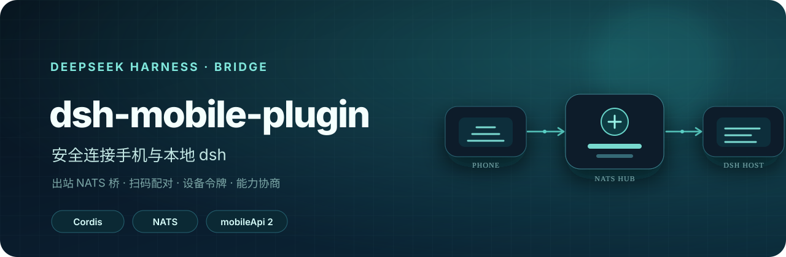
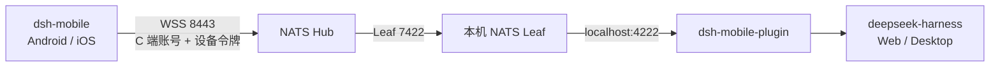

<div align="center">



# dsh-mobile-plugin

**把本地 DeepSeek Harness 安全地带到手机上的 Cordis 插件。**

插件主动连接 NATS Hub，把 dsh 的 RPC 与实时事件桥接给 [dsh-mobile](https://github.com/EarhartZhao/dsh-mobile)。电脑不需要公网 IP，也不需要开放任何入站端口。

<p>
  <a href="https://registry.npmjs.org/%40dsh-earhartzhao%2Fdsh-mobile-plugin"></a>
  <a href="https://github.com/EarhartZhao/dsh-mobile-plugin/releases/latest"></a>
  <a href="https://github.com/EarhartZhao/dsh-mobile-plugin/actions/workflows/ci.yml"></a>
  
  
</p>

[快速开始](#快速开始) · [安装](#安装) · [首次配置](#首次配置) · [连接 App](https://github.com/EarhartZhao/dsh-mobile) · [自建 Hub](docs/03-nats-self-host.md)

</div>

## 为什么需要它

dsh 通常跑在家用电脑或办公电脑上，没有公网 IP。手机直接访问不到它，而把 dsh 暴露到公网又会扩大攻击面。

本插件把连接方向反过来：电脑和手机都主动连接同一个 NATS Hub。Hub 只负责转发，插件仍运行在 dsh 进程内，因此会话、审批、提问、文件与工具事件都来自同一个宿主。



## 核心能力

| 连接 | 安全 | 移动体验 |
| --- | --- | --- |
| 宿主主动出站连接，不开放入站端口 | 扫码配对，设备令牌可单独吊销 | 完整 RPC、实时事件流与历史分页 |
| 复用 dsh Typert Remote 与事件词汇 | Hub CA 随二维码下发，不内置账号 | 子智能体、审批、提问、队列与文件 |
| 本机 NATS 探测、启动与链路诊断 | 每台安装自动生成独立 `instanceId` | 插件页与回环控制台使用同一套配置 |
| 支持 npm、Release tarball、Git 与本地 link | 密钥不进入移动端 wire 或诊断结果 | 控制台内检查更新，升级后提示重启 |

## 快速开始

开始前准备三样东西：

1. 能运行 `dsh web` 的电脑。
2. NATS Hub 地址、C 端账号密码，以及 Hub 的 `ca.crt`。
3. 本机 `nats-server` 与 `leaf.conf`；没有时按 [AI 接入清单](docs/04-ai-onboarding.md)准备。

在 dsh 的「插件」页安装并启用：

```text
@dsh-earhartzhao/dsh-mobile-plugin
```

然后打开插件配置区，按页面顺序完成：

1. **连接 Hub**：填写 Hub 地址、账号和密码。
2. **获取 CA**：粘贴 `ca.crt`，或点击「从 Hub 获取 CA」。
3. **启动本机 NATS**：状态显示已连接后继续。
4. **配对手机**：生成二维码，用 dsh-mobile 扫码。

> App `0.1.6` 支持插件 `>=0.2.2 <0.3.0`，当前 `mobileApi` 为 `2`。版本或能力不匹配时，App 会在连接阶段明确报错。

## 安装

### npm（推荐）

```bash
pnpm add @dsh-earhartzhao/dsh-mobile-plugin@latest
```

发布的 npm 包已经包含 `lib/`，安装时不会运行构建脚本，不需要配置 `allowBuilds`。也可以直接在 dsh 插件页按包名安装。npm 网页可能对部分网络环境返回 403，这不影响 registry 安装；包元数据可以直接从 [npm registry](https://registry.npmjs.org/%40dsh-earhartzhao%2Fdsh-mobile-plugin) 查看。

pnpm 11 默认有 24 小时的新版本发布年龄门禁。当天刚发布的版本可能暂时解析不到；需要立即安装时请显式指定版本。长期使用时可以把整包名加入 profile 的 `pnpm-workspace.yaml`：

```yaml
minimumReleaseAgeExclude:
  - '@dsh-earhartzhao/dsh-mobile-plugin'
```

### Release 预构建包

每次发布都会在 [GitHub Releases](https://github.com/EarhartZhao/dsh-mobile-plugin/releases/latest) 提供预构建 tarball：

```text
https://github.com/EarhartZhao/dsh-mobile-plugin/releases/latest/download/dsh-mobile-plugin.tgz
```

这种方式同样不运行构建脚本，适合无法访问 npm registry 的机器。

### Git 源码

```bash
pnpm add github:EarhartZhao/dsh-mobile-plugin
```

Git 安装会执行 `prepare` 构建。pnpm 10+ 首次会以 `ERR_PNPM_GIT_DEP_PREPARE_NOT_ALLOWED` 拒绝，并按 commit 给出精确的 `allowBuilds` 键。新机器优先使用 npm 或 Release 包，避免每个 commit 都重新批准构建。

<details>
<summary>开发机使用 link: 引用本仓库</summary>

在 profile 的 `package.json` 中使用：

```jsonc
{
  "dependencies": {
    "@dsh-earhartzhao/dsh-mobile-plugin": "link:<本仓库路径>"
  }
}
```

使用 `link:`，不要使用 `file:`。`file:` 会复制当前内容，源码变化后 pnpm 不会自动重打包。Windows 上还要保持本仓库的 `node_modules` 没有符号链接；本仓库因此固定 `nodeLinker: hoisted`。

</details>

### 安装后必须启用

包被加入 profile 依赖还不够。插件页里的「启用」会把包名写进 `dsh.profile.bundles`，包内 `cordis.patch.yml` 提供的 `mobile-bridge` 行才会生效。

没启用时 `/mobile-bridge` 会直接返回 404。装好后如果仍显示「declares no dsh.bundle」，通常是 profile 里物化了旧副本；在 profile 目录重新执行 `pnpm install`。

<details>
<summary>从旧裸包名 dsh-mobile-plugin 迁移</summary>

`0.2.27` 起包名改为 `@dsh-earhartzhao/dsh-mobile-plugin`。旧 profile 里按包名断言的覆盖行不会自动匹配新包，Hub 配置会静默失效。

先停止 dsh，再运行：

```bash
node scripts/migrate-to-scoped.mjs ~/.dsh/profiles/web
```

脚本会安装新包、原地替换 `dsh.profile.bundles` 中的旧包名、修正 `id: mobile-bridge` 行的 `name`，并移除旧依赖。修改前会备份 `cordis.patch.yml`；备份中含有明文密码，不要提交。

</details>

### 升级后重启 dsh

宿主始终使用启动时加载的 JavaScript。升级插件后，磁盘上的版本可能已经是新版本，但运行中的仍是旧代码。

从 `0.2.45` 起，控制台更新按钮可以直接完成升级；如果宿主返回 `already-installed`，插件会自动执行一次替换，**不需要用户先卸载再安装**。升级完成后仍需重启 dsh：

- 终端启动：按 `Ctrl+C`，重新运行 `dsh web`。
- 桌面版：使用菜单「重启应用与 Host」。

控制台会在「插件版本」旁提示磁盘版本与运行版本不一致。

## 首次配置

手机使用插件里配置的 Hub 凭证，App 不内置任何账号。因此必须先配置插件，再生成二维码。

### 1. Hub 地址与账号

打开「侧边栏 → 插件 → `@dsh-earhartzhao/dsh-mobile-plugin`」，或访问：

```text
http://127.0.0.1:3080/mobile-bridge
```

Hub 地址可以填写完整的 `wss://<host>:8443`，也可以只填主机或 IP。缺 scheme 时自动补 `wss://`，缺端口时自动补 `8443`。

### 2. Hub CA

手机不内置任何 CA，信任锚来自二维码。自签 Hub 必须配置 `ca.crt`。

- 已经有 `ca.crt`：直接粘贴并保存。
- 不知道 CA 在哪：点击「从 Hub 获取 CA」。
- Hub 只发送叶子证书：按钮会给出在 Hub 上拼 fullchain 的命令。

CA 是公开材料，不包含私钥；`ca.key` 应留在管理机，不能上传到 Hub。

### 3. 本机 NATS Leaf

点击「启动本地 NATS」。插件会先探测 `natsUrl`，端口已监听时直接复用；否则启动已经安装好的 `nats-server`。

查找顺序：

1. `NATS_SERVER_PATH` / `NATS_CONFIG_PATH` 环境变量。
2. 控制台「手动指定路径」。
3. `$DSH_HOME/mobile-bridge/`、`~/.nats-leaf/`、`~/.config/nats/`。
4. 平台常见目录与 `PATH`。

新电脑还没有 `nats-server` 和 `leaf.conf` 时，把 [docs/04-ai-onboarding.md](docs/04-ai-onboarding.md) 整页交给这台电脑上的 AI，按清单安装并完成自检。

### 4. 测试与配对

「测试 Hub 账号」会逐段检查：

| 检查项 | 失败时通常意味着 |
| --- | --- |
| `local` | 插件没有连上本机 NATS |
| `credentials` | Hub 账号或密码错误 |
| `hub-path` | 本机 Leaf 没有桥接到 Hub |
| `certificate` | 二维码 CA 与 Hub 实际证书不匹配 |

全部通过后点击「生成配对二维码」，用 App 扫码。凭证或 CA 未配置时不会发码，避免手机拿到一个必然失败的二维码。

## 实例 ID

`instanceId` 是这台安装在 Hub 上的命名空间：

```text
svc.dsh.<instanceId>.<method>
evt.dsh.<instanceId>.<eventKey>.mux
```

字段留空表示自动生成。第一次启动时会生成 8 位 ID（4 位毫秒时间戳 + 4 位随机），写入 `$DSH_HOME/mobile-bridge/instances.json`。

- 同一台电脑上的不同 dsh profile 各自拥有独立 ID。
- 升级、重装、重启不会改变 ID。
- 修改 ID 或更换安装路径后，已配对手机需要重新扫码。
- 多个实例共用同一个 ID 会互相抢答，事件也会串流。

## 凭证与配置分层

| 层 | 位置 | 用途 |
| --- | --- | --- |
| 组合层 | 包内 `cordis.patch.yml` | 非密默认值与 `mobile-bridge` 行 |
| 用户层 | profile 的 `cordis.patch.yml` | 本机 Hub 地址、账号、CA 与实例名 |
| 凭据层 | 环境变量或 `dsh-credentials-local` | 推荐的正式密码托管方式 |

控制台「保存」写的是 profile 覆盖行。`hubPass` 标记为 `secret`，非本机请求只能得知是否已配置；但当前值仍会以明文保存在 profile 文件中，因此不要提交或公开分享该文件。

## 已知边界

- **大文件不走 NATS。** Hub 单条消息约 1 MiB，插件只传有界文件窗口；更大的文件需要独立下载端点。
- **目录列表没有游标。** 宿主默认最多返回 2000 项，超出时只标记 `truncated`。
- **CA 指纹尚未强制校验。** App 会保存并展示指纹，但 RN WebSocket 暂时拿不到对端证书。
- **没有系统级后台推送。** 审批与提问提醒目前只在 App 前台有效。
- **文件变更流不是操作系统监视器。** 只覆盖 dsh 自己记录的读写事件。

## 开发与验证

需要 Node.js 22+ 与 pnpm 11。本地集成测试还需要 `nats-server`。

```bash
pnpm install
pnpm run typecheck
pnpm run typecheck:client
pnpm test
pnpm run build
```

对运行中的宿主做端到端验收：

```bash
node scripts/fake-app.mjs nats://127.0.0.1:4222 <pairCode> home
node scripts/watch-probe.mjs nats://127.0.0.1:4222 home <scratchPath>
```

发布由 `v*` tag 触发。CI 会校验 tag、`package.json`、`src/bridge.ts` 的 `PLUGIN_VERSION` 与测试断言一致，然后构建并发布 tarball。发布流程见 [AGENTS.md](AGENTS.md)。

## 文档

| 文档 | 内容 |
| --- | --- |
| [00-plugin-plan.md](docs/00-plugin-plan.md) | 定位、架构、安装方式与决策记录 |
| [01-auth-pairing.md](docs/01-auth-pairing.md) | 双层凭证、配对流程与 token 存储 |
| [02-nats-server.md](docs/02-nats-server.md) | 复用现有 NATS Hub 的改动清单 |
| [03-nats-self-host.md](docs/03-nats-self-host.md) | 从零搭建 Hub、TLS、Leaf 与验收 |
| [04-ai-onboarding.md](docs/04-ai-onboarding.md) | 新电脑接入清单，可直接交给 AI 执行 |

历史版本说明见 [GitHub Releases](https://github.com/EarhartZhao/dsh-mobile-plugin/releases)。
